<div class="opening-slide">
  <div class="opening-copy">
    <p class="opening-kicker">Beyond the Prompt</p>
    <h1 class="opening-title">
      <span>Building a multi-step</span>
      <span>image generation workflow</span>
    </h1>
    <p class="opening-subtitle">With the Cloudflare Agents SDK</p>
  </div>

  <div class="opening-footer">
    <div class="text-left">
      <strong>Jamund Ferguson</strong>
      <a href="https://www.x.com/anxietytech">@anxietytech</a>
    </div>
    <div class="opening-event">
      <span>CityJS Athens</span>
      <strong>2026 🇬🇷</strong>
    </div>
  </div>
</div>

<!--
Hi, I'm Jamund Ferguson. I'm currently at Axle Energy, but I spent the last two years at Stability AI leading the front-end team and building UIs for image generation. Primarily a tool called Brand Studio.
-->

---

<div class="absolute inset-6 grid grid-cols-[7fr_5fr] items-center gap-8">
  <div class="h-full min-w-0 flex items-center justify-center">
    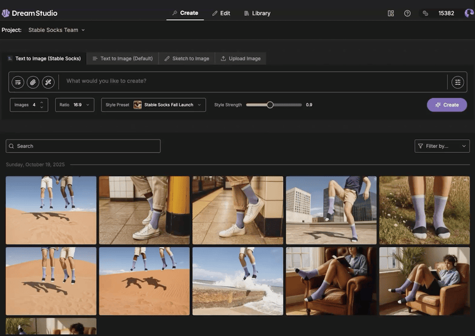
  </div>
  <div class="pl-2">
    <h2 class="!mt-0 !mb-4">Brand Studio</h2>
    <p>Generates marketing images <br/> from a text prompt box</p>
  </div>
</div>

<!--
I mainly worked on a tool called brand studio, which helps companies edit and generate images used in marketing campaigns.

As you can see here we throw up a big text box in front of people and asks them what they want to create.

-->

---

<h1><span class="text-yellow text-shadow-lg">HAVE YOU SEEN THIS MAN?</span></h1>

<!--
Trying to describe an image to a diffusion model is kind of like those police sketches where you have to describe the features that you want them to draw and they do their best to interpret it
-->
<div class="flex flex-row gap-4 p-4">
  <figure class="w-100"s>
    
    <figcaption><a class="text-xs" href="https://www.independent.co.uk/news/weird-news/worst-police-sketch-ever-police-hunt-oddly-spherical-man-9075276.html">The Independent: Worst police sketch ever? Police hunt oddly spherical man
  </a></figcaption>
  </figure>
  <div>
  <div class="absolute text-[2.5em] leading-[.75] text-shadow-sm">
Humans in general are fairly bad at describing people in great detail.
  <br/><br/>But the details really matter.
  </div>
  </div>
</div>

<!--
  This is kind of how I think about prompting an image generation model. <br/><br/> Like you're describing a criminal a sketch arist. <br/><br/>
-->


---

## ❌ Writing Bad Prompts

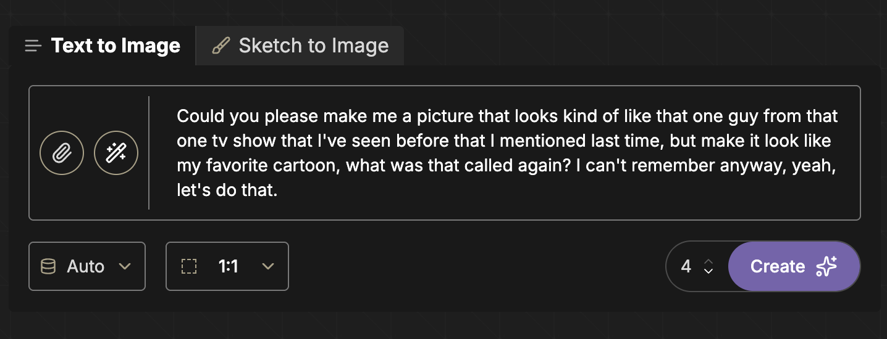

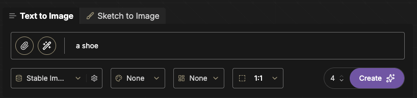

<!--

People have been kind of trained to treat prompt boxes like this, like chat boxes, and expect the history to remember the things that they talked about in the past. They also expect that it should be able to access the internet to add more context, which none of that's true in our diffusion models.

On the opposite end of the spectrum, people write these really tiny prompts with no details and expect to get some kind of high quality output, which is unrealistic.
-->

---
---

<h2 className="!m-0 !p-0 uppercase">Too Many Models</h2>

<div class="flex flex-row gap-4">

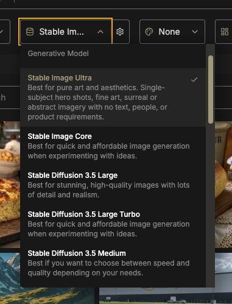

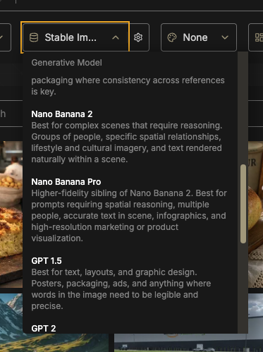

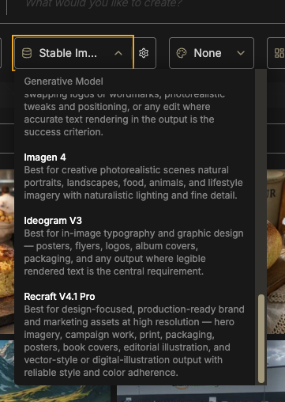

</div>

<!-- It's overwheleming right, and each have different strengths and weaknesses that aren't obvious to our customers -->

---

<div class="flex flex-row justify-center">
  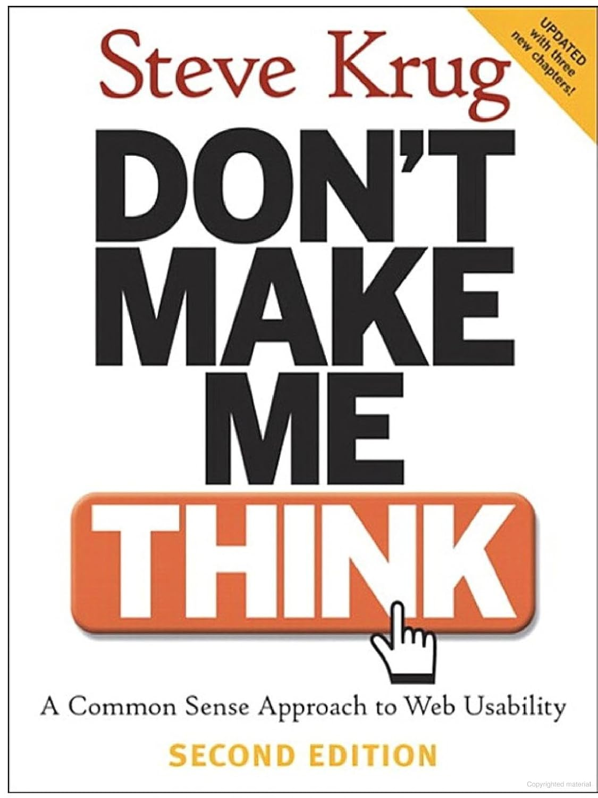
</div>

<!--
We're breaking the golden rule of UX
-->

---

<div class="flex flex-col items-center">
  <h2 class="uppercase text-shadow-lg"><span class="text-violet-200">People Want To Sell Their Own Stuff</span></h2>
  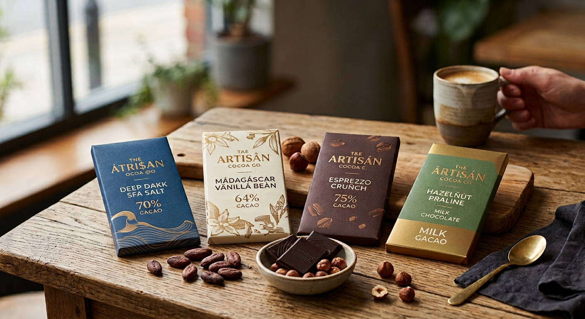
  <p class="!mb-4 text-sm font-bold tracking-[0.16em] text-green uppercase">Not your AI slop chocolate</p>    
</div>
<!-- They don't want to sell your AI slop chocolate bars with random typos -->

---
layout: section

---

# Image Models are a Black Box

<div class="flex flex-col items-center">
  <p class="text-green font-light w-180 !leading-tight p-0 text-shadow-sm text-shadow-black">People generally don't understand what they're doing or how to improve their output</p>

  
  <sub class="relative -top-6 !text-xs !p-0 text-slate-600">Image: Warner Bros. Pictures</sub>
</div>
---
layout: section

---

<p class="!mb-4 text-sm font-bold tracking-[0.16em] text-violet-300 uppercase">Part 2 · Thinking outside the prompt</p>

# A better interface for image generation

<!--
At stability I worked with a fantastic product manager Max who was constantly vibe coding different prototypes for how users could get better results out of our product.

Obviously, there are so many different ways we could think about solving this problem. I'm going to talk about just a few of the approaches that we took, what worked and didn't work about them, and how we ended up combining them all together into a feature that we call producer mode


Google combined autoregressive language-model behaviour with diffusion and other techniques. We were not Google and did not have many ML researchers, so Max proposed a complicated solution that lived mostly in the product workflow.
-->

---

# AI Prompt Enhancement

<ModelBadge
  v-click
  class="absolute right-7 bottom-6 z-20 w-88"
  :step="1"
  title="Enhance prompt"
  model-type="LLM"
  model="Mistral Small 4"
/>

<video src="./assets/prompt-enhance.mov" class="w-full" autoplay  controls></video>

<!--

 The first thing that we brought in was this AI prompt enhancement feature. Essentially, you type in your bad prompt, you click the little magic button, we send it to an LLM, and you get back a much more detailed prompt, which you can then edit before requesting your image.

It worked okay, but it definitely wasn't enough.
-->

---

# Auto-Model Selection

<ModelBadge
  v-click="2"
  class="absolute right-7 bottom-6 z-20 w-88"
  :step="2"
  title="Auto Model Selection"
  model-type="Decision Model"
  model="Jev, Clef or Decisions API"
  tone="current"
/>

<div v-click="1" class="absolute">

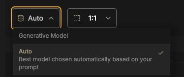

</div>

<div v-click.hide="1" class="flex flex-row gap-4">


</div>

<!--
As you can see from this very long dropdown, there are a tonne of model choices that we offer in Brand Studio. And nobody ever wants to think about the best one for their pick.
-->

---

# DON'T MAKE ME TYPE

<!--
Trying to describe an image to a diffusion model is kind of like those police sketches where you have to describe the features that you want them to draw and they do their best to interpret it
-->
<div class="flex flex-row gap-4">
  <figure>
    
    <figcaption><a class="text-xs" href="https://www.independent.co.uk/news/weird-news/worst-police-sketch-ever-police-hunt-oddly-spherical-man-9075276.html">The Independent: Worst police sketch ever? Police hunt oddly spherical man
  </a></figcaption>
  </figure>
  <figure>
  <div v-click.hide="1" class="absolute text-[2.5em] leading-[1.2] text-shadow-navy text-shadow-lg text-yellow">
  If you were describing someone specific, what would be the quickest way to convey that information?
  </div>
    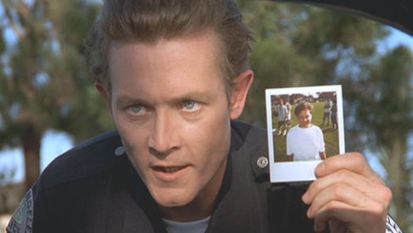
    <figcaption  v-click="1"  class="text-xs">Waynes World</figcaption>
  </figure>
</div>
---

<div class="flex flex-row justify-center">
    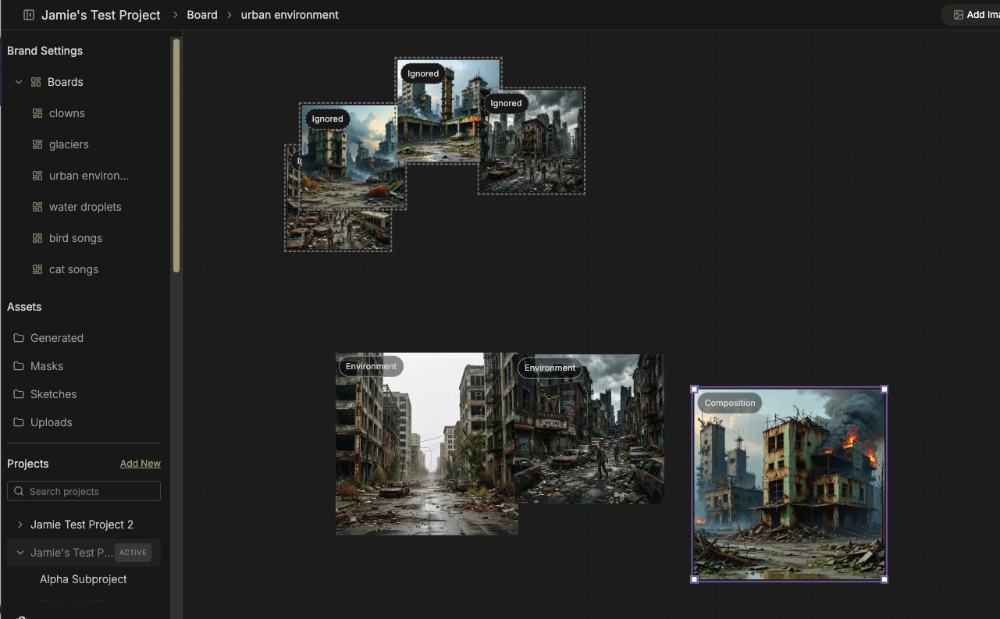
</div>

<ModelBadge
  v-click="2"
  class="absolute right-7 bottom-6 z-20 w-88"
  :step="3"
  title="Describe Images"
  model-type="Vision LM (VLM)"
  model="Gemini 3.1 Flash-Lite"
/>

<!--
 Instead of expecting people to very carefully type the perfect description about what they want, why not just have them show you?

 And then we'll use a vision language model or a multi-modal VLM such as Gemini 3.1-flash lite to provide a description of that image.
-->

---

<div class="absolute inset-10 grid grid-cols-[1fr_28rem] items-center gap-14">
  <div>
    <p class="!mb-3 text-sm font-bold tracking-[0.2em] text-green uppercase">A Partial AI Workflow</p>
    <h1 class="!m-0 text-6xl leading-tight text-blue">Creative<br/>Guidance</h1>
    <p class="mt-6 max-w-md text-xl leading-relaxed text-slate-300">
      Use moodboard images to enhance the users image prompt and then pick
      the best model
    </p>
  </div>

  <div class="flex flex-col gap-4">
    <ModelBadge
      class="w-full"
      :step="1"
      title="Describe Moodboard Images"
      model-type="Vision LM (VLM)"
      model="Gemini 3.1 Flash-Lite"
    />
    <ModelBadge
      class="w-full"
      :step="2"
      title="Enhance prompt"
      model-type="LLM"
      model="Mistral Small 4"
    />
    <ModelBadge
      class="w-full"
      :step="3"
      title="Auto Model Selection"
      model-type="Decision Model"
      model="Jev, Clef or Decisions API"
    />
  </div>
</div>

<!--
So if you combine all those together (prompt enhancement, auto model, and auto model routing with the mood board), you get this feature that we call creative guidance.
-->

---

<div class="mt-4 flex justify-center items-center">
  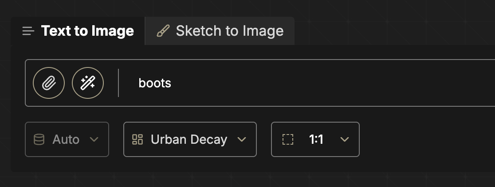
  
  
</div>

<!--
 You can see here, even with a very simple prompt like a boot, you get a really detailed image of a pair of boots in a really dystopian urban scene.
-->


---

<p v-click class="!mb-4 text-sm font-bold tracking-[0.16em] uppercase">OUR CUSTOMERS DON'T WANT TO SELL MY AI-GENERATED BOOTS</p>

<div class="mt-4 gap-4 flex justify-evenly items-center">
  
  
</div>

<!--
Prompt: Replace the boots in this image with a stack ION chocolate bars

They don'tw want to sell my AI generated boots, they want to sell their own products...
-->

---

<div class="flex flex-row justify-center">
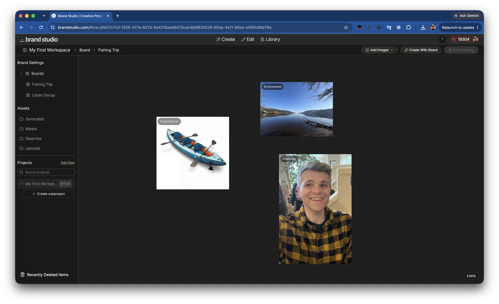
</div>

<!--
So we added some new capabilities to our moodboard.
-->

<!--
<center>
  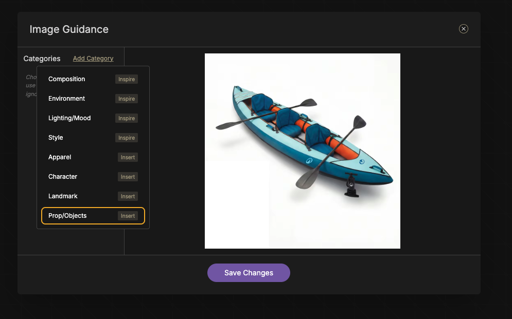
</center>

-->
---

  
<div class="absolute right-4 p-4 pl-8 gap-4 flex flex-col text-right w-100">
    <p class="!mb-3text-sm font-bold tracking-[0.2em] text-green uppercase">Product Insertion Loop</p>
    <p class="pl-4 mt-6 max-w-md text-xl leading-relaxed text-slate-300">
      Replace items in your base image with people and products from your moodboard.
    </p>
</div>

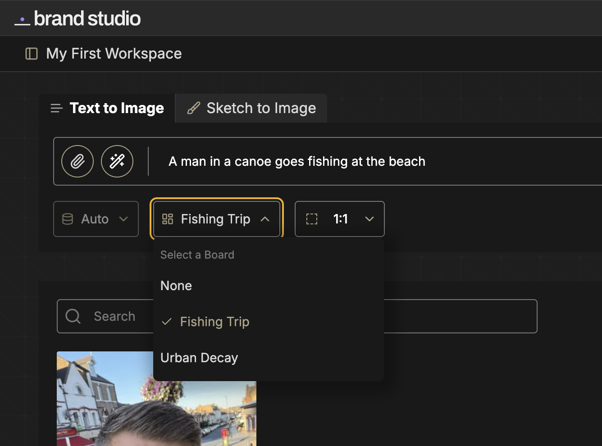

---

<div class="relative -top-20">
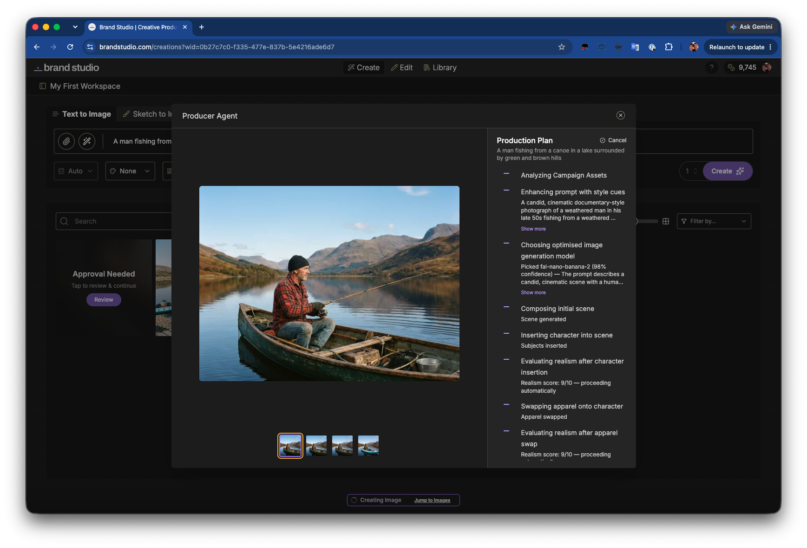


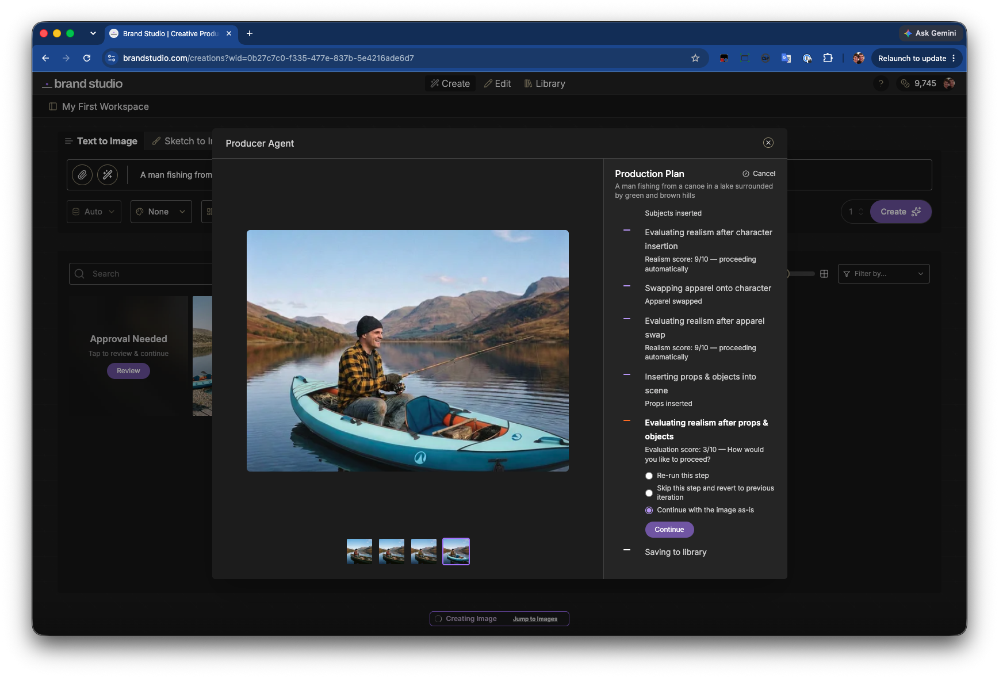
<ModelBadge
  v-click
  class="absolute right-7 top-20 z-50 w-88"
  :step="4"
  title="Insert Product(s)"
  model-type="Inpaint Model"
  model="Nano Banana Pro"
/>
<ModelBadge
  v-click
  class="absolute right-7 top-42 z-50 w-88"
  :step="5"
  title="Evaluate Realism"
  model-type="Multi-Modal LLM"
  model="Gemini Flash 3.8"
/>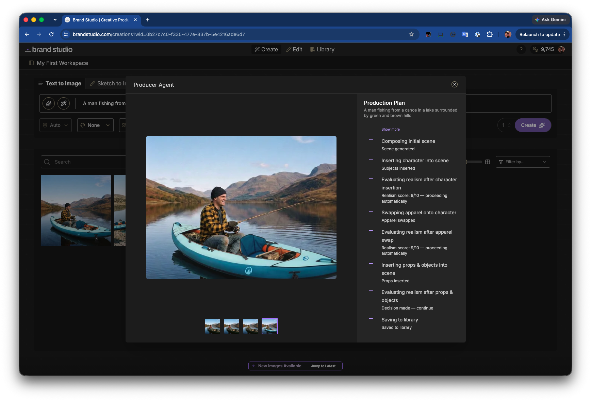

</div>

---

<div class="absolute pr-4 grid grid-cols-[1fr_28rem] items-center gap-14">
  <div>
    <p class="!mb-3 text-sm font-bold tracking-[0.2em] text-green uppercase">Our Full AI Workflow</p>
    <h1 class="!m-0 text-6xl leading-tight text-blue">Producer<br/>Mode</h1>
    <p class="mt-6 max-w-md text-xl leading-relaxed text-slate-300">
      Use moodboard images to enhance the users prompt. Pick
      the best model. Loop through product images and replace
      AI versions with the real thing. Evaluate for realism.
    </p>
  </div>

  <div class="flex flex-col gap-4">
    <ModelBadge
      class="w-full"
      :step="1"
      title="Describe Moodboard Images"
      model-type="Vision LM (VLM)"
      model="Gemini 3.1 Flash-Lite"
    />
    <ModelBadge
      class="w-full"
      :step="2"
      title="Enhance prompt"
      model-type="LLM"
      model="Mistral Small 4"
    />
    <ModelBadge
      class="w-full"
      :step="3"
      title="Auto Model Selection"
      model-type="Decision Model"
      model="Jev, Clef or Decisions API"
    />
    <div class="rounded-xl border-2 border-dashed border-fuchsia p-4 gap-4 flex flex-col">
    <ModelBadge
      class="w-full"
      :step="4"
      title="Insert Product(s)"
      model-type="Inpaint Model"
      model="Nano Banana Pro"
    />
    <ModelBadge
      class="w-full"
      :step="5"
      title="Evaluate Realism"
      model-type="Multi-Modal LLM"
      model="Gemini Flash 3.8"
    />
    </div>
  </div>
</div>

<!--
So if you combine all those together (prompt enhancement, auto model, and auto model routing with the mood board), you get this feature that we call creative guidance.
-->


---
layout: section
transition: none
---

<p class="!mb-4 text-sm font-bold tracking-[0.16em] text-violet-300 uppercase">Part 3 · Making the Workflow</p>

# Let's Build The Thing

How hard can it be?

<!--

Now for the fun bit, how did we build it?
-->

---

# Cloudflare Concepts

<CloudflareRings />

<!--
This is a conceptual product stack, not a literal inheritance diagram.
Cloudflare Agents build on Durable Objects. Workflows provide durable execution for applications on Workers, and the Agents SDK can be used with Workflows. The CDN represents the global Cloudflare network beneath the application runtime.

Sources:
https://developers.cloudflare.com/agents/runtime/lifecycle/agent-class/
https://developers.cloudflare.com/workflows/
https://developers.cloudflare.com/workflows/get-started/durable-agents/
https://developers.cloudflare.com/reference-architecture/architectures/cdn/

CDN: Worldwide distributed edge network, nice for serving image files and caching requests to your website.

Workers: are very similar to AWS lambdas, except they run at the edge, so they're extremely low latency , and they're built using something called V8 isolates instead of containers so there are almost no cold start costs.

Almost everything that Cloudflare has built is built since then is built on top of Workers.

On of the most unique features of Cloudflare is called durable objects which builds on workers by giving each instance a unique name, a local database and a “hibernating” WebSocket connection that it can use to connect directly with clients.


Whereas Workers are a sort of a generic serverless compute platform, with durable objects you can assign every user or organization their own cute little dedicated stateful computing instance.


Durability means being able to recover after a crash or for example if the instance gets "evicted" because the data is stored in database, not in the workers memory.
-->

---

<div class="absolute inset-10 flex flex-col">
  <p class="!mb-2 text-sm font-bold tracking-[0.2em] text-green uppercase">The architecture</p>
  <h1 class="!m-0 text-5xl text-blue">Our Two Challenges</h1>
  <div class="mt-7 grid h-[19.5rem] grid-cols-2 gap-7">
    <div class="flex flex-col overflow-hidden rounded-3xl border border-teal/60 bg-[#15172a] shadow-xl shadow-black/30">
      <div class="flex min-h-0 flex-1 flex-col p-5">
        <div class="mb-3 flex h-10 w-10 items-center justify-center rounded-xl bg-teal/15 text-base font-bold !text-green">01</div>
        <p class="!m-0 text-xs font-bold tracking-[0.14em] text-slate-400 uppercase">Orchestration</p>
        <h2 class="!m-0 text-[1.6rem] leading-tight text-white">Model and durably execute our AI workflows</h2>
        <p class="!mb-0 !mt-2 text-sm leading-snug text-slate-300">Long-running steps, retries, and observability.</p>
      </div>
      <div v-click class="border-t border-teal/40 py-3 px-6">
        <span class="text-sm font-bold tracking-[0.16em] text-green uppercase">Cloudflare Workflows</span>
      </div>
    </div>
    <div class="flex flex-col overflow-hidden rounded-3xl border border-purple/70 bg-[#17152b] shadow-xl shadow-black/30">
      <div class="flex min-h-0 flex-1 flex-col p-5">
        <div class="mb-3 flex h-10 w-10 items-center justify-center rounded-xl bg-purple/20 text-base font-bold text-purple">02</div>
        <p class="!m-0 text-xs font-bold tracking-[0.14em] text-slate-400 uppercase">Communication</p>
        <h2 class="!m-0 text-[1.6rem] leading-tight text-white">Sync the workflow state with the browser</h2>
        <div class="!mb-0 !mt-2 text-sm leading-snug text-slate-300">The UI should always show the latest progress. Clients needs to be able to direct the workflow.</div>
      </div>
      <div v-click class="border-t border-purple/50 py-3 px-6">
        <span class="text-sm font-bold tracking-[0.16em] text-purple uppercase">Cloudflare Agents SDK</span>
      </div>
    </div>
  </div>
</div>

---
layout: section
transition: none
---

# Cloudflare Workflows

Deterministically Executing our AI Workflows

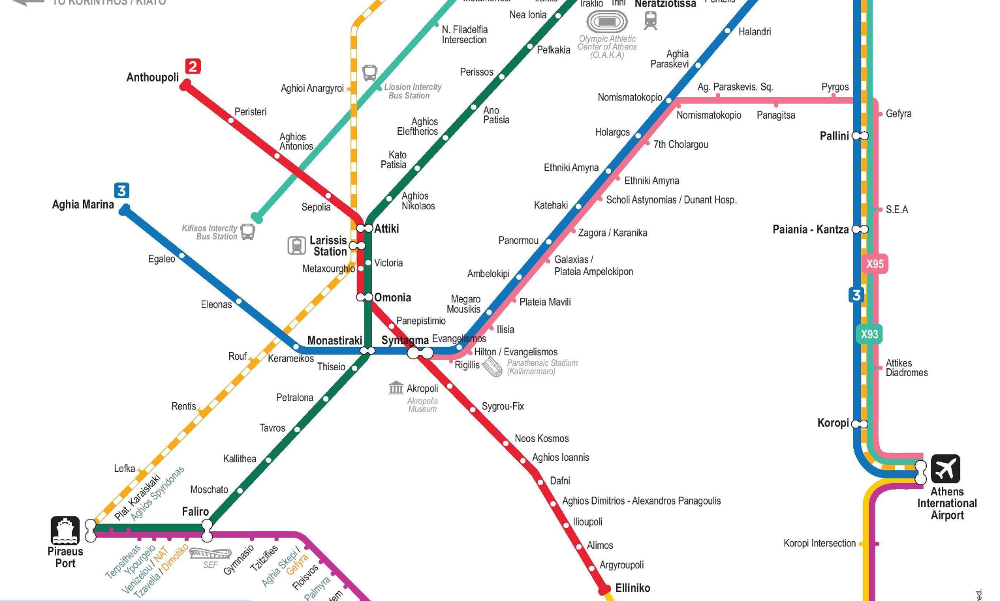

<!--
Let's define this very quickly, and then we'll turn it into code.
-->

---
transition: none
---

<div class="flex flex-row gap-4">
    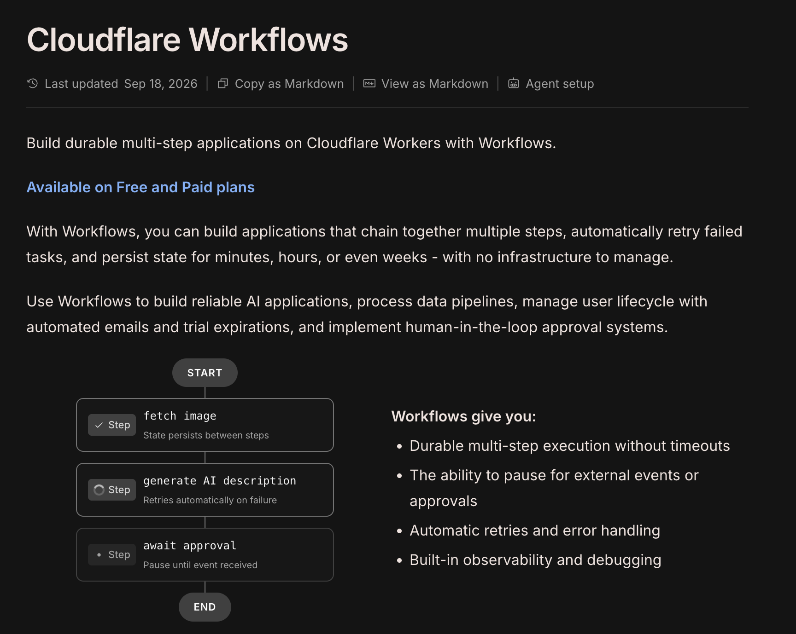
    <div class="flex flex-col gap-4">
    <ModelBadge
        v-click
        class="z-20 w-72"
        :step="1"
        title="Fetch Image"
        model-type="Service"
        model="R2"
        />
    <ModelBadge
        v-click
        class="z-20 w-72"
        :step="2"
        title="Generate Description"
        model-type="VLM"
        model="LLaVA 1.5 7B"
    />
    <ModelBadge
        v-click
        class="z-20 w-72"
        :step="3"
        title="Await Human Approval"
        model-type="Interface"
        model="Dashboard"
    />
    <ModelBadge
        v-click
        class="z-20 w-72"
        :step="4"
        title="Publish Description"
        model-type="Service"
        model="R2"
    />
    </div>
</div>

---
transition: none
---

```ts {1-2,24-25|3-6|8-15|17-19|21-23}
export class ImageProcessingWorkflow extends AgentWorkflow {
  async run(event: WorkflowEvent, step: WorkflowStep) {
    const imageData = await step.do("fetch image", async () => {
      const object = await this.env.BUCKET.get(event.payload.imageKey);
      return await object.arrayBuffer();
    });

    const description = await step.do("generate description", async () => {
      const imageArray = Array.from(new Uint8Array(imageData));
      return await this.env.AI.run("@cf/llava-hf/llava-1.5-7b-hf", {
        image: imageArray,
        prompt: "Describe this image in one sentence",
        max_tokens: 50,
      });
    });

    await step.waitForEvent("await approval", {
      event: "approved",
      timeout: "24 hours",
    });

    await step.do("publish", async () => {
      await this.env.BUCKET.put(`public/${event.payload.imageKey}`, imageData);
    });
  }
}
```

<!--
Sample Workflow Code
-->

---
transition: none
---

<h4 class="text-violet !text-md mb-3 w-full text-shadow-lg">Product Insertion Loop Example</h4>

```ts{|1-3|4-13|14-21}
let baseImage = image;
// loop over each category in the moodboard
for (const category in moodboard.categories) {
    // generate an image by replacing an item in the image with the moodboard image
    const activeImage = await step.do(`product insertion (${category.name})`, () => {
        const prompt = `We are in the process of making an image with the following description:
            ${enhancedPrompt}
            Replace the attached picture (2nd attachment) into the base image (1st attachment),
            replacing the ai generated version of this ${category.name} with the provided image.`
        const imageInput = [baseImage, category.image];
        const image = await this.env.AI.run("@google/nano-banana-2", { prompt, image_input });
        return image;
    });
    // evaluate for realism and override the base image if it passes
    const thing = await step.do(`evaluate image (${category.name})`, () => {
        const messages = ["Evalate this picture for realism on a scale of 0-1"];
        const result = await this.env.AI.run("@google/gemini-3.1-lite", { messages, attachments: [activeImage] });
        if (result.quality > .8) {
            baseImage = activeImage;
        } // else skip, log, ask for human input, etc...
        return result;
    });
}

```


---
layout: none
---
<div class="absolute inset-0 flex flex-col">
  <div class="relative mt-3 min-h-0 flex-1">
  <div class="absolute inset-0 overflow-hidden">
    
  </div>
  <div v-click class="absolute inset-0 overflow-hidden">
      </div>
  <div v-click class="absolute inset-0 overflow-hidden">
    
  </div>
  </div>
</div>

---

<h4 class="text-violet !text-md mb-3 w-full text-shadow-lg">Think of workflows as pre-determined places your AI can go.</h4>


---

<h4 class="text-violet !text-md mb-3 w-full text-shadow-lg">Agents are Tour Guides</h4>

<div class="flex flex-row gap-8">
    
    <div v-click class="bg-black/10 p-4 rounded-xl relative">
        <ul>    
            <li>Know about all the routes you could take</li>
            <li>Recommend correct route for each person</li>
            <li>Constantly in communication with everyone</li>
        </ul>
        <span v-click="2" class="absolute bottom-4 text-sm left-4"><span class="text-violet">*</span> There's an ongoing discussion about deterministic vs probabalistic AI workflows and what makes one "agentic".<br><span class="text-violet">I mostly don't care. I just want to build things.</span></span>
    </div>
</div>


---
layout: section
transition: none
---

# Cloudflare Agents SDK

Coordinate the work and keep us in sync

<!--
Let's define this very quickly, and then we'll turn it into code.
-->

<!-- ---
transition: none
---

<center>
   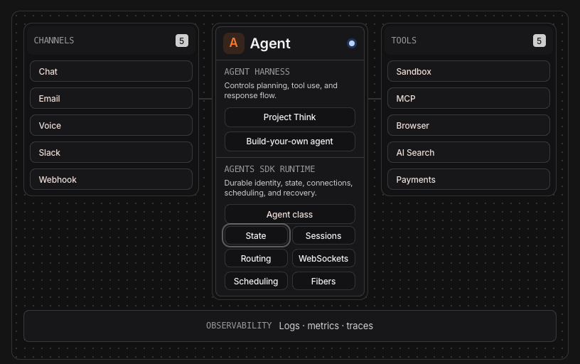
</center> -->

<!--
Cloudflare has got this entire choose your own adventure series of Agent-related infastructure we're only going taking advantage of a very small part of it.
-->

---
transition: none
---

<h4 class="text-violet !text-md mb-3 w-full text-shadow-lg">Agents SDK Basics</h4>

<div class="flex flex-row gap-4 justify-start h-106">

<div class="w-1/2 h-full">
  <span class="text-sm pl-2">Agent Code</span>
  <div class="flex flex-col w-full h-full rounded bg-black p-2"  style="background-color: var(--slidev-code-background)">

```ts{|3,8|4-7}
import { Agent, callable } from "agents";

export class MyAgent extends Agent {
  @callable()
  async greet(name: string): Promise<string> {
    return `Hello, ${name}!`;
  }
}
```
  </div>
</div>

<div class="w-1/2 h-full">
  <span class="text-sm pl-2">Client Code</span>
  <div class="flex flex-col w-full h-full rounded bg-black p-2"  style="background-color: var(--slidev-code-background)">

```ts {|5-7|9-11}
import { useAgent } from "agents/react";
import type { MyAgent } from "./server";

function App() {
  const agent = useAgent<MyAgent, State>({
    agent: "my-agent",
    name: "user-123",
  });

  // Call methods on the agent
  const greeting = await agent.stub.greet();
}
```
  </div>
</div>

</div>

<!--
The Agents SDK is used across the frontend and backend.

The hook itself is going to setup a web socket connection to the agent with
this particular name

You can make RPC calls by adding this decorator to your agent methods
-->

---

<h4 class="text-violet !text-md mb-3 w-full text-shadow-lg">Managing Agent State</h4>

<div class="flex flex-row gap-4 justify-start h-106">

<div class="w-1/2 h-full">
  <span class="text-sm pl-2">Agent Code</span>
  <div class="flex flex-col w-full h-full rounded bg-black p-2"  style="background-color: var(--slidev-code-background)">


```ts{|3-5,7-10|11-19|13,18|}
import { Agent, callable } from "agents";

type MyState = {
    name: string;
}
export class MyAgent extends Agent {
	initialState: MyState = {
		name: "",
	};

	@callable()
    async setName(name: string): Promise<string> {
        this.setState({ name: name });
    }

	@callable()
	async greet(): Promise<string> {
		return `Hello, ${this.state.name}!`;
	}
}
```

</div>
</div>
<div class="w-1/2 h-full">
  <span class="text-sm pl-2">Client Code</span>
  <div class="flex flex-col w-full h-full rounded bg-black p-2"  style="background-color: var(--slidev-code-background)">

```ts{|10|12}
import { useAgent } from "agents/react";
import type { MyAgent } from "./server";

function App() {
  const agent = useAgent<MyAgent, State>({
    agent: "my-agent",
    name: "user-123",
  });

  await agent.stub.setName("Jamund");

  await agent.stub.greet(); // "Hello, Jamund"
}
```

</div>
</div>
</div>
<!--
Remembmer, Agents are built on-top of durable, so they have state, but the agents class makes it much easier to work with than durable objects.

-->


---


<h4 class="text-violet !text-md mb-3 w-full text-shadow-lg">Agent state automatically syncs between client and server</h4>

<div class="flex flex-row gap-4 justify-start h-106">

<div class="w-1/2 h-full">
  <span class="text-sm pl-2">Agent Code</span>
  <div class="flex flex-col w-full h-full rounded bg-black p-2"  style="background-color: var(--slidev-code-background)">


```ts{10-14}
import { Agent, callable } from "agents";

type MyState = {
    name: string;
}
export class MyAgent extends Agent {
	initialState: MyState = {
		name: "",
	};

	@callable()
    async setName(name: string): Promise<string> {
        this.setState({ name: name });
    }

	@callable()
	async greet(): Promise<string> {
		return `Hello, ${this.state.name}!`;
	}
}
```

</div>
</div>
<div class="w-1/2 h-full">
  <span class="text-sm pl-2">Client Code</span>
  <div class="flex flex-col w-full h-full rounded bg-black p-2"  style="background-color: var(--slidev-code-background)">

```ts{|8-10|13|9-10}
import { useAgent } from "agents/react";
import type { MyAgent } from "./server";

function App() {
  const agent = useAgent<MyAgent, State>({
    agent: "my-agent",
    name: "user-123",
    onStateChanged: (state) => {
      console.log("New state:", state);
    }
  });

  await agent.stub.setName("Jamund");

  await agent.stub.greet(); // "Hello, Jamund"
}
```

</div>
</div>
</div>
<!--
Remembmer, Agents are built on-top of durable, so they have state, but the agents class makes it much easier to work with than durable objects.

-->

---

<h4 class="text-violet !text-md mb-3 w-full text-shadow-lg">Firing off a workflow and keeping it in state</h4>


```ts{|9-15,18|1,3,8,16-17}
type MyState = {
    name: string;
    activeWorkflows: string[]
}
export class MyAgent extends Agent {
	initialState: MyState = {
		name: "",
        activeWorkflows: []
	};

    @callable()
    async start(moodboardId: string, prompt: string): Promise<string> {
        const id = await this.runWorkflow("CREATIVE_GUIDANCE", {
            moodboardId, prompt
        });
        const activeWorkflows = this.state.activeWorkflows.concat(id);
        this.setState({ activeWorkflows })
        return { id };
    }

	// ...
}
```

---

<h4 class="text-violet !text-md mb-3 w-full text-shadow-lg">Showing Active Workflows</h4>


```ts{|5,9-11|14-16}
import { useAgent } from "agents/react";
import type { MyAgent } from "./server";

function App() {
  const [placeholders, setPlaceholders] = useState(); 
  const agent = useAgent<MyAgent, State>({
    agent: "my-agent",
    name: "user-123",
    onStateChanged: (state) => {
      setPlaceholders(state.activeWorkflows);
    }
  });

  return placeholders.map(workflowId => {
    return <PlaceholderCard workflowId={workflowId} />
  })
}
```


<!--
In real life we used a zustand store, but the pattern works well.
-->


---

<h4 class="text-violet !text-md mb-3 w-full text-shadow-lg">Removing Placeholders for Finished Workflows</h4>

<div class="flex flex-row gap-4 justify-start h-106">

<div class="w-1/2 h-full">
  <span class="text-sm pl-2">Workflow Code</span>
  <div class="flex flex-col w-full h-full rounded bg-black p-2"  style="background-color: var(--slidev-code-background)">


```ts{16-17}
// step 1
const moodboard = await step.do("collect moodboard data", async () => { /* ... */ });

// step 2
const newPrompt = await step.do("enhance prompt", () => { /* ... */ });

// step 3
const model = await step.do("select optimal model", () => { /* ... */ });

// step 4
const image = await step.do("generate image", () => { /* ... */ });

// step 5
await step.do("save to image library", () => { /* ... */ })

// only runs once
await step.reportComplete(image);

```

</div>
</div>
<div class="w-1/2 h-full">
  <span class="text-sm pl-2">Agent Code</span>
  <div class="flex flex-col w-full h-full rounded bg-black p-2"  style="background-color: var(--slidev-code-background)">


```ts{|10-13,18|14-17}
export class MyAgent extends Agent {
	initialState: MyState = {
		name: "",
        activeWorkflows: []
	};

    @callable()
    async start(moodboardId: string): Promise<string> { /* ... */ }

	async onWorkflowComplete(
		workflowName: string,
		instanceId: string,
		result?: GeneratedImage,
	) {
        const activeWorkflows = activeWorkflows
            .filter(id => id === instanceId);
		this.setState({ activeWorkflows })
	}

    // ...
}
```

</div>
</div>
</div>


---

<div class="flex flex-row justify-center">

<div class="flex flex-col  items-center">
        
### Monitoring Workflow Progress

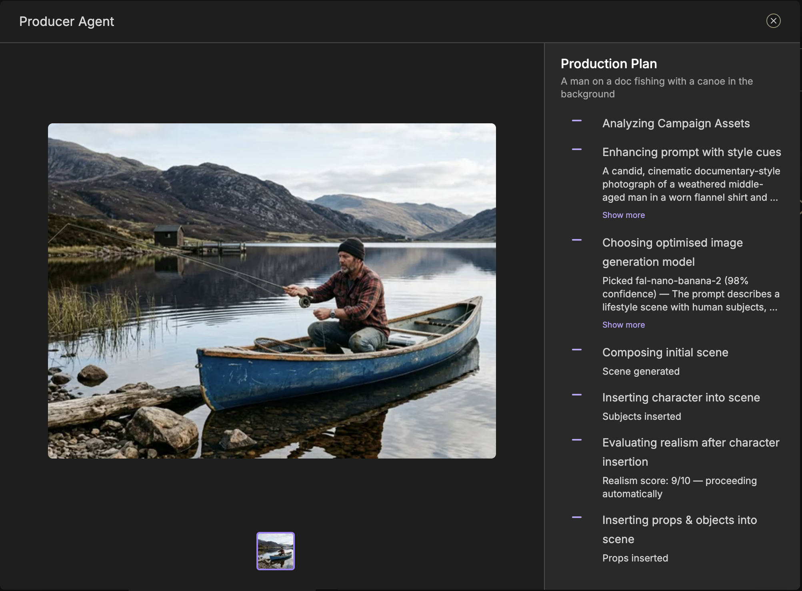

</div>

</div>

---

<h4 class="text-violet !text-md mb-3 w-full text-shadow-lg">Step-By Step Progress Updates</h4>

<div class="flex flex-row gap-4 justify-start h-106">

<div class="w-1/2 h-full">
  <span class="text-sm pl-2">Workflow Code</span>
  <div class="flex flex-col w-full h-full rounded bg-black p-2"  style="background-color: var(--slidev-code-background)">

```ts{|2-5|2-5,12-15}
await step.do("enhance prompt", async ({ step: { name }}) => {
    await this.reportProgress({
        step: name,
        status: "active"
    });
   
    const response = await this.env.AI.run(
        "@cf/mistralai/mistral-small-3.1-24b-instruct",
        { messages }
    );
    
    await this.reportProgress({
        step: name,
        status: "completed"
    });

    return response;

 });
```

</div>
</div>
<div class="w-1/2 h-full">
  <span class="text-sm pl-2">Agent Code</span>
  <div class="flex flex-col w-full h-full rounded bg-black p-2"  style="background-color: var(--slidev-code-background)">


```ts{|1-3,6|9-13|14-17|18-21}
type StepStatus = Record<StepName, "pending" | "active" | "completed">;
// { "enhance prompt": "completed", "generating image": "pending" }
type MyState = { activeWorkflows: Record<WorkflowId, StepStatus> }
export class MyAgent extends Agent {
	initialState: MyState = {
        activeWorkflows: {} 
	};

	async onWorkflowProgress(
		workflowName: string,
		instanceId: string,
		progress: MyState["activeWorkflows"],
	) {
        const steps = {
            ...this.state.activeWorkflows[instanceId],
            [progress.step]: progress.status,
        };
        this.setState({
            ...this.state.activeWorkflows,
            [instanceId]: steps
        });
	}
}
```

</div>
</div>
</div>

---
transition: none
---

<SystemArchitecture />

---
layout: section
transition: none
---

# Halloween is coming up...</br> 

<p>But building agents does not have to be scary</p>

---

<div class="flex gap-20 justify-center">
  
</div>

<!--
Pretty much all the stuff that we're going to talk about today is built on top of Cloudflare, which is the service that we are already using for hosting our web stuff. There are tonnes of other agent frameworks that we could have used to have built this, but in our case this seemed like a good bet.
-->


---
layout: section

---

## A FEW LAST THOUGHTS
#### We built an innovative workflow for image generation...and you can too.

---
layout: section
---

### THE END

---
