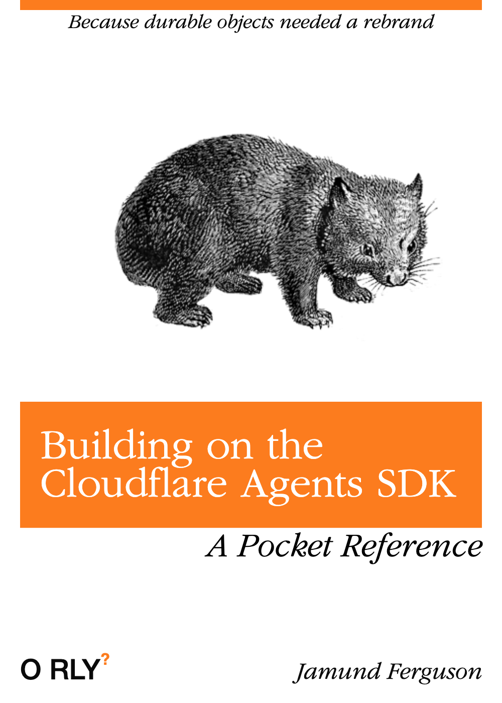
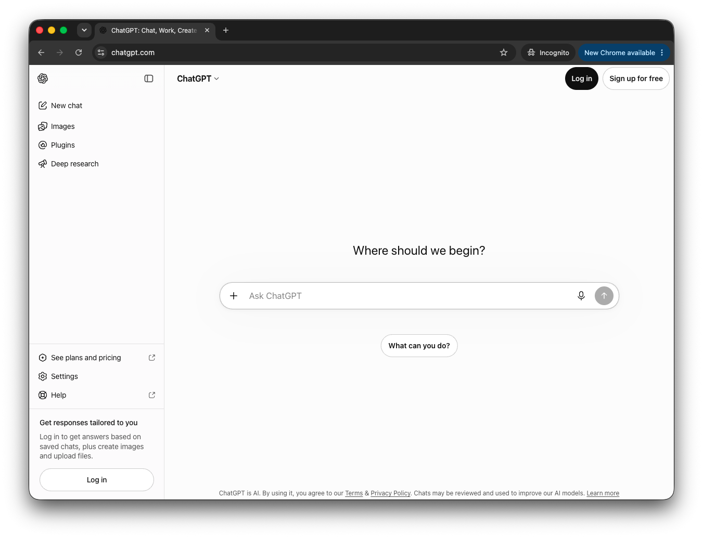

# Building a Multi-Step Agentic Image Generation Workflow


###  Jamund Ferguson 

#### CityJS Athens 2026 🇬🇷


<a href="https://www.x.com/anxietytech" class="text-teal">@anxietytech</a>


<!--
Hi, I'm Jamund Ferguson. I'm currently at Axle Energy, but I spent the last two years at Stability AI leading the front-end team and building UIs for image generation. Primarily a tool called Brand Studio.
-->


---

# Thinking Outside The Prompt

#### Interactive UIs in the age of agents

<br />
<br />
<br />
<br />
<br />
<br />
<br />
<br />
<br />

###  Jamund Ferguson <span class="text-sm">\[<a href="https://www.x.com/anxietytech" class="text-teal text">@anxietytech</a>\]</span>
#### CityJS Athens 2026 🇬🇷


<!--
Hi, I'm Jamund Ferguson. I'm currently at Axle Energy, but I spent the last two years at Stability AI leading the front-end team and building UIs for image generation. Primarily a tool called Brand Studio.
-->


---

<div class="flex gap-20 justify-center">
  
  
</div>

<!--
So my talk is going to be a bit about this stuff, but first I'm going to tell you a bit about what i've been working on
-->


---

<div class="absolute inset-6 grid grid-cols-[7fr_5fr] items-center gap-8">
  <div class="h-full min-w-0 flex items-center justify-center">
    
  </div>
  <div class="pl-2">
    <h2 class="!mt-0 !mb-4">Brand Studio</h2>
    <p>Generates marketing images from a text prompt.</p>
  </div>
</div>

<!--
I mainly worked on a tool called brand studio, which helps companies edit and generate images used in marketing campaigns.

As you can see here we throw up a big text box in front of people and asks them what they want to create. 

-->

---


<div class="absolute inset-6 flex flex-col">
  <div class="flex justify-center">
    <h2 class="!mt-0 !mb-4">People want to chat with the 🤖</h2>
  </div>
  
  
</div>

<!--

ChatGPT and Claude trained people to treat a big text box as a conversation. The logs showed many people trying to talk to a robot that could not understand them in that way.

-->
---

## ❌ Writing Bad Prompts


<!--
Lots of text, without specific detail isn't helpful. Neither are really generic approaches without much detail like "a shoe"

Both of these are going to result in poor quality output.
-->

---


<center>
<strong>Source:</strong> <a href="https://poloclub.github.io/diffusion-explainer/">https://poloclub.github.io/diffusion-explainer/</a>
</center>

<!--
Diffusion models learn by replacing pixels with static noise and learning to reverse that process while associating the image with its description. Starting with noise and text, the model guesses the missing pixels. The book analogy is crossing out words and characters, then asking someone to reconstruct the text.

-->

---

## Prompt detail matters


<center>
<strong>Source:</strong> <a href="https://poloclub.github.io/diffusion-explainer/">https://poloclub.github.io/diffusion-explainer/</a>
</center>

<!--
Here's another graphic from the same site demonstrating how important it is to layer details into the prompt. Slight changes in the wording or in the text can end up creating drastically different images.
-->

---
<!--

## A better model?

When Google released Nano Banana Pro in late 2025 they combined the natural language capabilities of an LLM, the power of Google Search, and the X power of XYY. 

<!--
Google combined autoregressive language-model behaviour with diffusion and other techniques. We were not Google and did not have many ML researchers, so our product manager Max proposed a complicated solution that lived mostly in the product workflow.

-->

---

## A better interface for image generation

We need to think outside the prompt

<!--
At stability I worked with a fantastic product manager Max who was constantly vibe coding different prototypes for how users could get better results out of our product.
-->
---

# Part 2
## Make it Work(flow)

---

<div class="absolute inset-6 grid grid-cols-[5fr_7fr] items-stretch gap-8">
  <div class="flex flex-col justify-center pr-2">
    <p class="!mb-2 text-sm font-bold tracking-[0.16em] text-violet-300 uppercase">Step 1 of 6</p>
    <h2 class="!mt-0 !mb-4">Enhance the prompt</h2>
    <p>Mistral Small 4 turns a short request into a useful image description.</p>
    <p class="text-slate-400">The user can stay brief while the prompt enhancer supplies visual detail and structure.</p>
  </div>
  <WorkflowDiagram :active="1" />
</div>

<!--
If someone types “a shoe,” convert it into something more detailed. It might not be the exact shoe they wanted, but it adds flair, teaches better prompting, and converts conversational input into an image description.
-->

---

<div class="absolute inset-6 grid grid-cols-[5fr_7fr] items-stretch gap-8">
  <div class="flex flex-col justify-center pr-2">
    <p class="!mb-2 text-sm font-bold tracking-[0.16em] text-violet-300 uppercase">Step 2 of 6</p>
    <h2 class="!mt-0 !mb-4">Route to the image model</h2>
    <p>JEV compares the enhanced prompt with a fixed list of model capabilities.</p>
    <p class="text-slate-400">For this marketing image, it selects Stable Image Ultra.</p>
  </div>
  <WorkflowDiagram :active="2" />
</div>

<!--
Cartoons and hyperreal images may need different models. Even Stability's own family offered many options. The routing model JEV takes context and selects from a list of precomputed options.
-->

---

<div class="absolute inset-6 grid grid-cols-[5fr_7fr] items-stretch gap-8">
  <div class="flex flex-col justify-center pr-2">
    <p class="!mb-2 text-sm font-bold tracking-[0.16em] text-violet-300 uppercase">Step 3a of 6</p>
    <h2 class="!mt-0 !mb-4">Build the moodboard</h2>
    <p>Let users show the scene, style, subject, or mood they want.</p>
    <p class="text-slate-400">They add reference images and label each image's role.</p>
  </div>
  <WorkflowDiagram :active="3" :moodboard-stage="2" />
</div>

<!--
People struggle to describe what they see. Police sketches and charades are hard for the same reason. Showing beats describing, so users collect a scene, style, or vibe and label what matters in a moodboard.
-->

---

<div class="absolute inset-6 grid grid-cols-[5fr_7fr] items-stretch gap-8">
  <div class="flex flex-col justify-center pr-2">
    <p class="!mb-2 text-sm font-bold tracking-[0.16em] text-violet-300 uppercase">Step 3b of 6</p>
    <h2 class="!mt-0 !mb-4">Process the references</h2>
    <p>Gemini Flash 3.8 describes each reference according to its moodboard role.</p>
    <p class="text-slate-400">The workflow saves the descriptions and injects them before prompt enhancement.</p>
  </div>
  <WorkflowDiagram :active="3" :moodboard-stage="5" />
</div>

<!--
Users add images and categorise each one as a background, subject, or another role. A VLM describes the images, the product saves those descriptions, and the workflow injects them before prompt enhancement. At generation time, it pulls the descriptions rather than the original images. The result mixes the user's text with the moodboard guidance.
-->

---

<div class="absolute inset-6 grid grid-cols-[5fr_7fr] items-stretch gap-8">
  <div class="flex flex-col justify-center pr-2">
    <p class="!mb-2 text-sm font-bold tracking-[0.16em] text-violet-300 uppercase">Step 4 of 6</p>
    <h2 class="!mt-0 !mb-4">Generate the base image</h2>
    <p>Stable Image Ultra creates the first complete image from the enhanced prompt and visual guidance.</p>
    <p class="text-slate-400">This establishes the composition before branded elements are added.</p>
  </div>
  <WorkflowDiagram :active="4" :moodboard-stage="5" />
</div>

---

<div class="absolute inset-6 grid grid-cols-[5fr_7fr] items-stretch gap-8">
  <div class="flex flex-col justify-center pr-2">
    <p class="!mb-2 text-sm font-bold tracking-[0.16em] text-violet-300 uppercase">Step 5 of 6</p>
    <h2 class="!mt-0 !mb-4">Insert branded assets</h2>
    <p>Add the real product, person, prop, or place that the campaign must feature.</p>
    <p class="text-slate-400">An inpainting model places each tagged asset into the generated base image.</p>
  </div>
  <WorkflowDiagram :active="5" :moodboard-stage="5" />
</div>

<!--
Good base images still fail when a company needs its own product, person, prop, or place. The team added product-like categories to moodboards and used an inpainting model to insert every tagged item into the base image.
-->

---

<div class="absolute inset-6 grid grid-cols-[5fr_7fr] items-stretch gap-8">
  <div class="flex flex-col justify-center pr-2">
    <p class="!mb-2 text-sm font-bold tracking-[0.16em] text-violet-300 uppercase">Step 6 of 6</p>
    <h2 class="!mt-0 !mb-4">Evaluate and review</h2>
    <p>Gemini Flash 3.8 scores the result and sends uncertain images to a person.</p>
    <p class="text-slate-400">Accept finishes. Retry repeats insertion. Skip returns to the base image.</p>
  </div>
  <WorkflowDiagram :active="6" :moodboard-stage="5" />
</div>

<!--
The workflow takes a long time and the output risks becoming AI slop, so the user needs to see where they are in the multi-step process. A VLM produces a slop score, and a high score sends the result to a person. The human remains the final decision maker. The exact choices in the notes are: accept it, throw it away and start over, or use the previous image and skip the step.

Stability's applied AI team relied on ComfyUI, which models image manipulation as a graph of nodes, inputs, and outputs stored as JSON. It is excellent, but it felt like a black box for a product that needed constant progress communication with the client.
-->

---

# Part 3
## Agents

---

## Interactivity without chat

Most AI SDKs assume the product is a chatbot. This product needed an interactive workflow instead.

<!--
The wider option set included LangChain, Mastra, Cloudflare Agents SDK, CodeMode, Workflows, Dynamic Workflows, Vercel tools, Vercel AI SDK, TanStack AI, CrewAI, and others. The exact current names should be checked before the talk.

-->

---

## Two architecture problems

1. Arrange and execute a multi-step image workflow
2. Synchronise progress and feedback between the agent and browser

---

## Early attempt: LangChain

- Awkward fit with Cloudflare's serverless environment
- No native client state synchronisation
- Large learning surface and a lot of code
- More capable than we needed, but still a valid choice

<!--
LangChain remained compelling, especially if chat might be added later. The criticism is about fit and complexity, not that the framework is bad.

-->
---
## Cloudflare Quirks

Bindings &amp; Migrations

<!--
Instead of maing a normal REST API call to use cloudflare's internal services, they have you register "bindings"
for each app that then will give you a typed SDK to enable the feature and typically execute commands over fast
RPC connection

Because durable objects are at least part database, they require a version in this migrations config, so that
if you make major changes to the data structure, you can bring everyone along
-->

---

## Cloudflare Workers

Temporary compute close to the request.

<!--
Workers resemble AWS Lambda but run on Cloudflare's edge network. They use V8 isolates rather than containers, which reduces cold-start overhead. Workers can communicate with one another.

-->

---

## Durable Objects

A named, stateful compute instance with local storage and a hibernating WebSocket.

<!--
Each user or organisation can have a dedicated stateful instance. It sleeps when unused and retains its data when it wakes. This became the primitive for Cloudflare's agent framework.

-->


---

## Cloudflare Agents SDK

```ts
this.setState({
  status: "running",
  progress: 0.4,
})
```

<!--
setState is backed by SQL. A change on the server or frontend immediately notifies the other side over WebSocket. A React hook establishes the connection, and decorators expose backend methods to clients. This solves client/server communication with little custom work.

-->

---

## Cloudflare Workflows

```ts
await step.do("enhance prompt", enhancePrompt)
await step.do("route model", routeModel)
await step.do("generate image", generateImage)
```

<!--
Workflows model durable multi-step processes and provide observability for each step. Add a dashboard screenshot, the full happy-path pipeline, and the trickier wait-for-response example later.

-->

---

## Agents plus workflows

An agent workflow communicates progress from the workflow to the agent, then immediately to the browser.

> **Diagram placeholder:** Agent, workflow, and browser state synchronisation

---

## Human decisions inside the workflow

- Accept
- Skip
- Retry

<!--
Accept and skip were straightforward. Retry required more creative modelling. Add the real code example and expand the retry path when ready.

-->

---

## Deterministic and probabilistic workflows

Does an agent need to choose every model, tool, and argument?

---

## Deterministic where possible

- Cheaper because a model does not decide every turn
- Easier to test because the possible paths are known
- A practical way to encode human taste
- Humans do not need to cede all control yet

---

## What the happy path leaves out

- Frontend state modelling
- Mapping workflow state into the UI
- Creative mistakes and edge cases
- Observability and failure modes

<!--
The happy-path agent code was roughly 100 lines for complex capabilities. Offer to discuss the omitted engineering details offline.

-->

---

# Part 4
## What happened next

---

## The product problem

One-shot prompts could not reliably create the marketing images users needed.

<!--
The team augmented human abilities with agentic ones while keeping final decisions with people.

-->

---

## We built something we were proud of

> **Image placeholder:** Beautiful Producer Mode marketing images

---

## We shipped it

🎉

---

## Two weeks later, the team shut down

New sign-ups stopped. We never learned whether we had solved the UX.

---

## Build something you can be proud of

Even if nobody ever sees it.

Build a feature worth talking about after you leave.

---

# Thank you, Athens 🇬🇷

---

## Appendix: problems and evals

1. The workflow cannot arbitrarily restart at earlier steps
2. Failed-step output is hidden; only the retry is visible
3. Combining image generation and evaluation weakens observability

<!--
These points appeared after the main ending in the original notes. Keep them for Q&A or a deeper technical version.
-->
