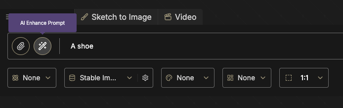
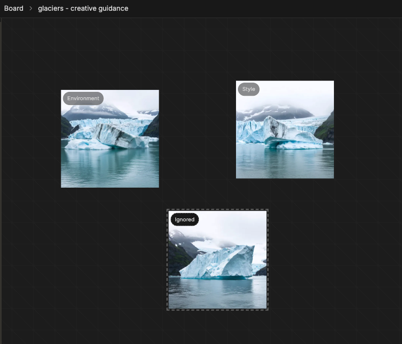
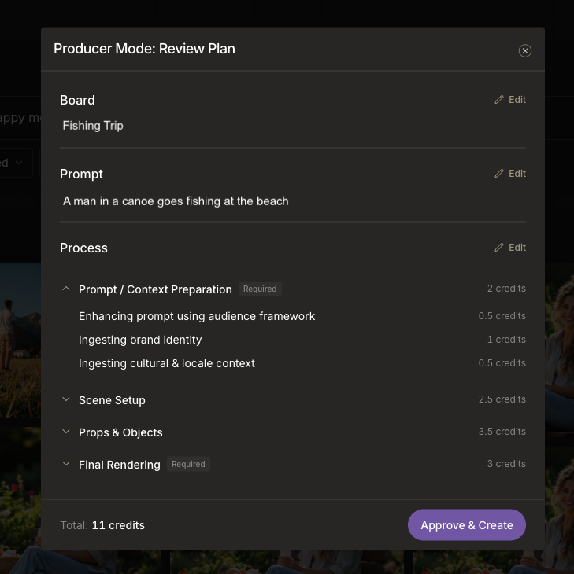
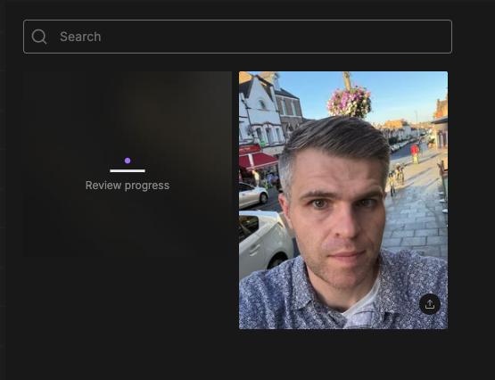
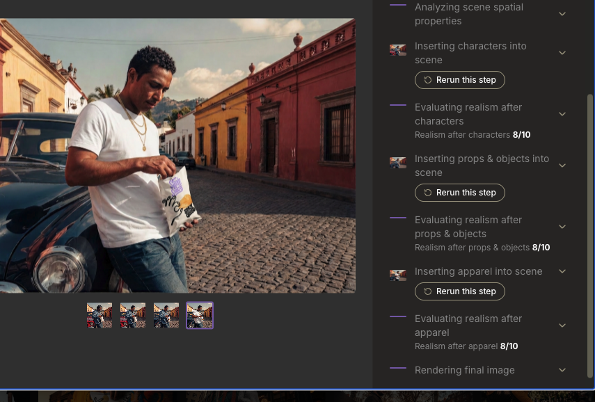
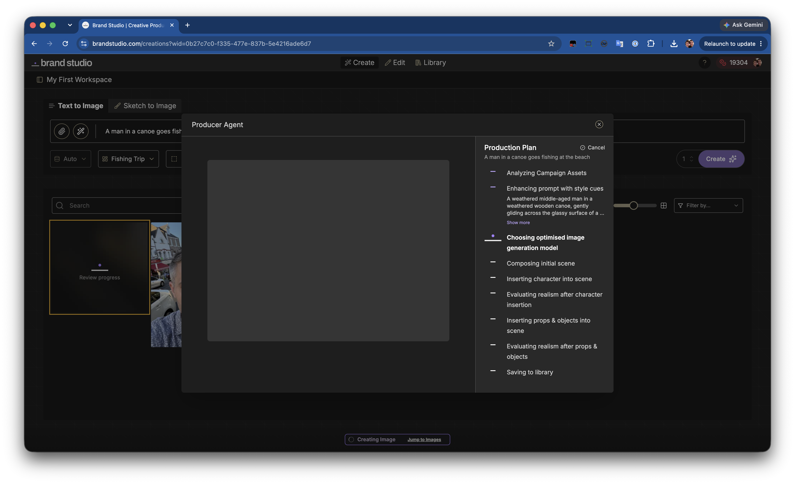
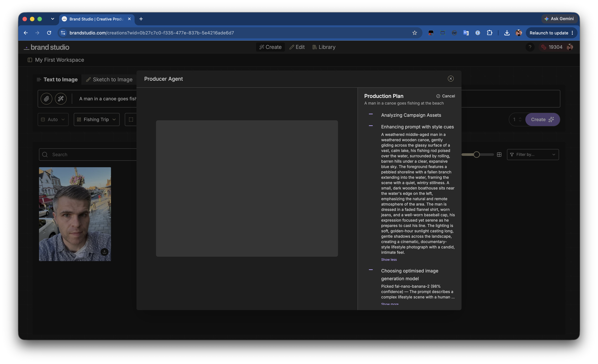
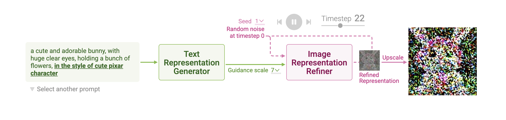
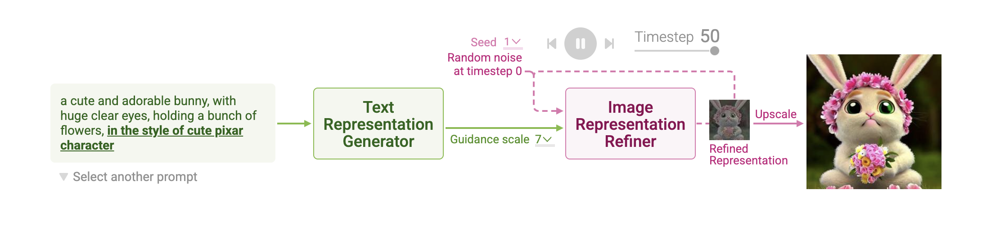
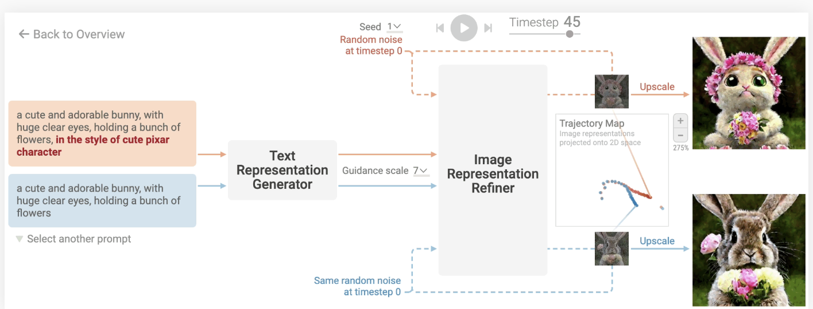

<div class="opening-slide">
  <div class="opening-copy">
    <p class="opening-kicker">Beyond the Prompt</p>
    <h1 class="opening-title">
      <span>Building a multi-step</span>
      <span>image generation workflow</span>
    </h1>
    <p class="opening-subtitle">With the Cloudflare Agents SDK</p>
  </div>

  <div class="opening-footer">
    <div class="text-left">
      <strong>Jamund Ferguson</strong>
      <a href="https://www.x.com/anxietytech">@anxietytech</a>
    </div>
    <div class="opening-event">
      <span>CityJS Athens</span>
      <strong>2026 🇬🇷</strong>
    </div>
  </div>
</div>


<!--
Hi, I'm Jamund Ferguson. I'm currently at Axle Energy, but I spent the last two years at Stability AI leading the front-end team and building UIs for image generation. Primarily a tool called Brand Studio.
-->

---

<div class="absolute inset-6 grid grid-cols-[7fr_5fr] items-center gap-8">
  <div class="h-full min-w-0 flex items-center justify-center">
    
  </div>
  <div class="pl-2">
    <h2 class="!mt-0 !mb-4">Brand Studio</h2>
    <p>Generates marketing images <br/> from a text prompt box</p>
  </div>
</div>

<!--
I mainly worked on a tool called brand studio, which helps companies edit and generate images used in marketing campaigns.

As you can see here we throw up a big text box in front of people and asks them what they want to create. 

-->

---

<h2><span class="text-white ">4 UX Challenges</span></h2>

<div class="grid grid-cols-2 h-100 gap-4 text-black font-bold">
  <div class="bg-red p-4 shadow-lg shadow-black">
    1. It's really hard to write a good prompt
  </div>
  <div class="bg-orange p-4 shadow-lg shadow-black">
    2. There are a tonne of different image models to choose from
  </div>
  <div class="bg-yellow p-4 shadow-lg shadow-black">
    3. People want to see their brand, or in some cases themselves, represented in the output
    </div>
  <div class="bg-blue p-4 shadow-lg shadow-black">
    4. An overall lack of creative control over the image generation process
  </div>
</div>


---

## ❌ Writing Bad Prompts




<!--

People have been kind of trained to treat prompt boxes like this, like chat boxes, and expect the history to remember the things that they talked about in the past. They also expect that it should be able to access the internet to add more context, which none of that's true in our diffusion models. 

On the opposite end of the spectrum, people write these really tiny prompts with no details and expect to get some kind of high quality output, which is unrealistic.
-->

---
layout: section

---

<h2 className="!m-0 !p-0">Too Much Model Choice</h2>

<div class="flex flex-row gap-4">


</div>

<!-- It's overwheleming right, and each have different strengths and weaknesses that aren't obvious to our customers -->

---

<center>
  <h2>People Want To Sell Their Own Stuff</h2>
  
<p class="!mb-4 text-sm font-bold tracking-[0.16em] text-violet-300 uppercase">Not your AI slop chocolate</p>

</center>
<!-- They don't want to sell your AI slop chocolate bars with random typos -->


---
layout: section

---

# Image Models are a Black Box

<center>
  <p class="text-black w-180 !leading-none p-0">People don't really understand how they work and have really no idea how to steer them in one direction or another.</p>

  
  <sub class="relative -top-6 !text-xs !p-0 text-slate-600">Image: Warner Bros. Pictures</sub>
</center>
---
layout: section

---

<p class="!mb-4 text-sm font-bold tracking-[0.16em] text-violet-300 uppercase">Part 2 · Thinking outside the prompt</p>

# A better interface for image generation


<!--
At stability I worked with a fantastic product manager Max who was constantly vibe coding different prototypes for how users could get better results out of our product.

Obviously, there are so many different ways we could think about solving this problem. I'm going to talk about just a few of the approaches that we took, what worked and didn't work about them, and how we ended up combining them all together into a feature that we call producer mode 


Google combined autoregressive language-model behaviour with diffusion and other techniques. We were not Google and did not have many ML researchers, so Max proposed a complicated solution that lived mostly in the product workflow.
-->


---

# AI Prompt Enhancement

<ModelBadge
  v-click
  class="absolute right-7 bottom-6 z-20 w-88"
  :step="1"
  title="Enhance prompt"
  model-type="LLM"
  model="Mistral Small 4"
/>

<video src="./assets/prompt-enhance.mov" class="w-full" autoplay  controls></video>

<!--

 The first thing that we brought in was this AI prompt enhancement feature. Essentially, you type in your bad prompt, you click the little magic button, we send it to an LLM, and you get back a much more detailed prompt, which you can then edit before requesting your image.

It worked okay, but it definitely wasn't enough.
-->

---

# Auto-Model Selection

<ModelBadge
  v-click="2"
  class="absolute right-7 bottom-6 z-20 w-88"
  :step="2"
  title="Auto Model Selection"
  model-type="Decision Model"
  model="Jev, Clef or Decisions API"
  tone="current"
/>

<div v-click="1" class="absolute">


</div>


<div v-click.hide="1" class="flex flex-row gap-4">


</div>


<!--
As you can see from this very long dropdown, there are a tonne of model choices that we offer in Brand Studio. And nobody ever wants to think about the best one for their pick.
-->

---

# Moodboards


<!--
Trying to describe an image to a diffusion model is kind of like those police sketches where you have to describe the features that you want them to draw and they do their best to interpret it
-->
<div class="flex flex-row gap-4">
  <figure>
    
    <figcaption><a class="text-xs" href="https://www.independent.co.uk/news/weird-news/worst-police-sketch-ever-police-hunt-oddly-spherical-man-9075276.html">The Independent: Worst police sketch ever? Police hunt oddly spherical man
  </a></figcaption>
  </figure>
  <figure>
  <p v-click.hide="1" class="absolute">
  This is kind of how I think about describing an image to an image generation model. <br/><br/>Sure, you try to remember the features, but who knows if you forgot some important details?
  <br/><br/>The details really matter.
  </p>
    
    <figcaption  v-click="1"  class="text-xs">Waynes World</figcaption>
  </figure>
</div>
---

<center>

</center>

<!-- 
 Instead of expecting people to very carefully type the perfect description about what they want, why not just have them show you?
-->

---

<center class="text-lg text-neutral-300">Prompt Enhancement ➕ Auto-Model Routing ➕ Moodboard 🟰 Creative Guidance</center>

<div class="mt-4 flex justify-center items-center">
  
  
</div>

<!--
So if you combine all those together (prompt enhancement, auto model, and auto model routing with the mood board), you get this feature that we call creative guidance. You can see here, even with a very simple prompt like a boot, you get a really detailed image of a pair of boots in a really dystopian urban scene.
-->

---

<center class="text-xl text-neutral-300">Creative Guidance: <span class="text-blue">Boots in a Glacier</span></center>

<div class="mt-4 flex justify-evenly items-center">
  
  
</div>

<!--
Here's another example of creative guidance. I put a couple of pictures of a glacier in the moodboard, and I got this really cool picture of boots hanging out by a frozen lake.
-->


---
layout: section
transition: none
---


<h1 class="uppercase "><span class="!text-green">There is a problem <br/> here though</span></h1>

---


<p class="!mb-4 text-sm font-bold tracking-[0.16em] text-green uppercase">OUR CUSTOMERS DON'T WANT TO SELL MY AI-GENERATED BOOTS</p>


<div class="mt-4 gap-4 flex justify-evenly items-center">
  
  
</div>

<!--
Prompt: Replace the boots in this image with a stack ION chocolate bars

They don'tw want to sell my AI generated boots, they want to sell their own products...

-->

---

<center>

</center>

<!--
So we added some new capabilities to our moodboard.
-->

---

<center>

</center>

<!--
 For each image that was added, you could categorise it as either an inspiration image to impact the style of the OUTPUT or a product image to be INSERTED into the ouput.

So here i added a canoe, and I also have a picture of myself.

Along with a INSPIRATION image of loch ness
-->


---

# GETTING RID OF THE BLACK BOX

<center class="flex flex-row gap-4">
  
  
  
</center>

<!--
And finally to get rid of the black box, the first thing we're going to do is show the
customers the image generation plan before we even start (and potentially allow them to change it) and secondly as the the images are generating, 

-->

---

# GETTING RID OF THE BLACK BOX

<center>
    
  

</center>


<!--
NOTE: MAYBE DO A BETTER JOB HERE
-->

---

### We finally nailed the UX (more or less)

<div class="mt-8 p-4">

<ol>
  <li class="!list-decimal">Create a moodboard (style & product images)</li>
  <li class="!list-decimal">Type a simple prompt</li>
  <li class="!list-decimal">We generate the image for them in multiple steps including: 
      <p class="pl-4 !m-0">• building the base image</p>
      <p class="pl-4 !m-0">• inserting any product images</p>
      <p class="pl-4 !m-0">• evaluating for realism</p>
  </li>
  <li class="!list-decimal">Users can both observe and maintain control over every step in the process</li>
</ol>

</div>

---
layout: section
transition: none
---

<p class="!mb-4 text-sm font-bold tracking-[0.16em] text-violet-300 uppercase">Part 3 · Making the Workflow</p>

# Let's Build The Thing

Building Agent is Fun (Sometimes)

<!--

Now for the fun bit, how did we build it?
-->


---

<div class="flex gap-20 justify-center">
  
</div>

<!--
So my talk is going to be a bit about this stuff, but first I'm going to tell you a bit about what i've been working on
-->
---
transition: none

---

<div class="absolute inset-6 grid grid-cols-[2fr_1fr] items-stretch gap-8">
  <div class="flex flex-col justify-center pr-2">
    <p class="!mb-2 text-sm font-bold tracking-[0.16em] text-violet-300 uppercase">Step 1 of 5</p>
    <h2 class="!mt-0 !mb-4">Enhance the prompt</h2>
    <p>Mistral Small 4 turns a short request into a useful image description.</p>
    <p class="text-slate-400">The user can stay brief while the prompt enhancer supplies visual detail and structure.</p>
  </div>
  <WorkflowDiagram :active="1" />
</div>

<!--
If someone types “a shoe,” convert it into something more detailed. It might not be the exact shoe they wanted, but it adds flair, teaches better prompting, and converts conversational input into an image description.
-->

---
transition: none

---

<div class="absolute inset-6 grid grid-cols-[2fr_1fr] items-stretch gap-8">
  <div class="flex flex-col justify-center pr-2">
    <p class="!mb-2 text-sm font-bold tracking-[0.16em] text-violet-300 uppercase">Step 2 of 5</p>
    <h2 class="!mt-0 !mb-4">Route to the best image generation model</h2>
    <p>JEV compares the enhanced prompt with a fixed list of model capabilities.</p>
    <p class="text-slate-400">For this marketing image, it selects Stable Image Ultra.</p>
  </div>
  <WorkflowDiagram :active="2" />
</div>

<!--
Cartoons and hyperreal images may need different models. Even Stability's own family offered many options. The routing model JEV takes context and selects from a list of precomputed options.
-->

---
transition: none

---

<div class="absolute inset-6 grid grid-cols-[2fr_1fr] items-stretch gap-8">
  <div class="flex flex-col justify-center pr-2">
    <p class="!mb-2 text-sm font-bold tracking-[0.16em] text-violet-300 uppercase">Step 3a of 5</p>
    <h2 class="!mt-0 !mb-4">Build the moodboard</h2>
    <p>Let users show the scene, style, subject, or mood they want.</p>
    <p class="text-slate-400">They add reference images and label each image's role.</p>
  </div>
  <WorkflowDiagram :active="3" :moodboard-stage="2" />
</div>

<!--
People struggle to describe what they see. Police sketches and charades are hard for the same reason. Showing beats describing, so users collect a scene, style, or vibe and label what matters in a moodboard.
-->

---
transition: none

---

<div class="absolute inset-6 grid grid-cols-[2fr_1fr] items-stretch gap-8">
  <div class="flex flex-col justify-center pr-2">
    <p class="!mb-2 text-sm font-bold tracking-[0.16em] text-violet-300 uppercase">Step 3b of 5</p>
    <h2 class="!mt-0 !mb-4">Process the references</h2>
    <p>Gemini 3.8 Flash-Lite describes each reference according to its moodboard role.</p>
    <p class="text-slate-400">Moodboard creation ends after saving. Its output then feeds Step 1 prompt enhancement.</p>
  </div>
  <WorkflowDiagram :active="3" :moodboard-stage="5" />
</div>

<!--
Users add images and categorise each one as a background, subject, or another role. A VLM describes the images, the product saves those descriptions, and the workflow injects them before prompt enhancement. At generation time, it pulls the descriptions rather than the original images. The result mixes the user's text with the moodboard guidance.
-->

---
transition: none

---

<div class="absolute inset-6 grid grid-cols-[2fr_1fr] items-stretch gap-8">
  <div class="flex flex-col justify-center pr-2">
    <p class="!mb-2 text-sm font-bold tracking-[0.16em] text-violet-300 uppercase">Step 4 of 5</p>
    <h2 class="!mt-0 !mb-4">Generate the base image</h2>
    <p>Stable Image Ultra creates the first complete image from the enhanced prompt and visual guidance.</p>
    <p class="text-slate-400">This establishes the composition before branded elements are added.</p>
  </div>
  <WorkflowDiagram :active="4" :moodboard-stage="5" />
</div>

---
transition: none

---

<div class="absolute inset-6 grid grid-cols-[2fr_1fr] items-stretch gap-8">
  <div class="flex flex-col justify-center pr-2">
    <p class="!mb-2 text-sm font-bold tracking-[0.16em] text-violet-300 uppercase">Step 5a of 5</p>
    <h2 class="!mt-0 !mb-4">Inpaint people</h2>
    <p>Nano Banana 2 inpaints each required person before the workflow regenerates and evaluates the image.</p>
    <p class="text-slate-400">A score below 80% sends the image to a person for a decision.</p>
  </div>
  <WorkflowDiagram :active="5" :moodboard-stage="5" :asset-stage="1" />
</div>

<!--
Good base images still fail when a company needs its own product, person, prop, or place. The team added product-like categories to moodboards and used an inpainting model to insert every tagged item into the base image.
-->

---
transition: none

---

<div class="absolute inset-6 grid grid-cols-[2fr_1fr] items-stretch gap-8">
  <div class="flex flex-col justify-center pr-2">
    <p class="!mb-2 text-sm font-bold tracking-[0.16em] text-violet-300 uppercase">Step 5b of 5</p>
    <h2 class="!mt-0 !mb-4">Inpaint products</h2>
    <p>Nano Banana 2 repeats the inpainting cycle for every product the campaign must feature.</p>
    <p class="text-slate-400">A score below 80% asks a person whether the product needs another pass.</p>
  </div>
  <WorkflowDiagram :active="5" :moodboard-stage="5" :asset-stage="2" />
</div>

<!--
People and products run through separate insertion, generation, and evaluation cycles. Each evaluation can return to its own insertion step.
-->

---
transition: none

---

<div class="absolute inset-6 grid grid-cols-[2fr_1fr] items-stretch gap-8">
  <div class="flex flex-col justify-center pr-2">
    <p class="!mb-2 text-sm font-bold tracking-[0.16em] text-violet-300 uppercase">Step 5c of 5</p>
    <h2 class="!mt-0 !mb-4">Complete asset inpainting</h2>
    <p>Nano Banana 2 handles inpainting. Gemini Flash 3.8 evaluates the result against an 80% realism threshold.</p>
    <p class="text-slate-400">Anything below the quality gate pauses the workflow and asks a person.</p>
  </div>
  <WorkflowDiagram :active="5" :moodboard-stage="5" :asset-stage="3" />
</div>

<!--
The workflow does not need to regenerate every branded asset when only one insertion fails. Each lane loops independently before the complete image moves forward.

The workflow takes a long time and the output risks becoming AI slop, so the user needs to see where they are in the multi-step process. A VLM produces a slop score, and a high score sends the result to a person. The human remains the final decision maker. The exact choices in the notes are: accept it, throw it away and start over, or use the previous image and skip the step.

Stability's applied AI team relied on ComfyUI, which models image manipulation as a graph of nodes, inputs, and outputs stored as JSON. It is excellent, but it felt like a black box for a product that needed constant progress communication with the client.
-->

---
transition: none
class: workflow-code-slide

---

## The workflow as code

```ts {all|1-3|5-7|9-11|13-15|17-24}
const moodboard = await step.do("collect moodboard data", () =>
  agent.describeMoodboard(campaign.moodboard)
)

const enhancedPrompt = await step.do("enhance prompt", () =>
  agent.enhancePrompt(campaign.prompt, moodboard)
)

const model = await step.do("select optimal model", () =>
  agent.selectModel(enhancedPrompt)
)

let image = await step.do("generate base image", () =>
  agent.generateImage(model, enhancedPrompt)
)

for (const category of ["people", "products", "landmarks", "props"]) {
  image = await step.do(`insert ${category}`, () =>
    agent.insertMoodboardImages(image, moodboard[category])
  )

  await step.do(`evaluate ${category}`, () =>
    agent.evaluateRealismOrAskHuman(image)
  )
}
```

<!--
This is deliberately pseudocode rather than the production implementation. The important point is that the visual workflow maps cleanly to named, durable steps. Each step can retry independently, and the category loop carries the latest image into the next insertion.
-->

---
transition: none
class: workflow-code-slide model-call-slide

---

```ts {all|1-5|7-11|13-30}
const moodboard = await step.do("collect moodboard data", async () => {
  const result = await env.AI.run("google/gemini-3.8-flash", {
    contents: [moodboardMessage(campaign.moodboard)],
  })
  return parseMoodboard(textOf(result))
})

const enhanced = await step.do("enhance prompt", async () => {
  const result = await env.AI.run("mistral/mistral-small-4", {
    messages: [enhanceMessage(prompt, moodboard)],
  })
  return textOf(result)
})

const model = await step.do("select optimal model", async () => {
  const result = await env.AI.run("typesafe/jev", {
    state: enhanced,
    questions: { imageModel: {
      type: "choice",
      instructions: "Which Stable Image model best fits?",
      criteria: {
        "stability/stable-image-ultra": "Art or product detail",
        "stability/stable-image-core": "Quick experimentation",
        "stability/stable-diffusion-3.5-large": "Highest realism",
        "stability/stable-diffusion-3.5-large-turbo": "Fast quality",
        "stability/stable-diffusion-3.5-medium": "Balanced",
      },
    } },
  })
  return result.imageModel
})
```

---
transition: none
class: workflow-code-slide model-call-slide

---

```ts {all|1-6|8-14|16-22}
let image = await step.do("generate base image", async () => {
  const result = await env.AI.run(model, {
    prompt: enhanced, aspect_ratio: "16:9",
  })
  return result.image
})

for (const category of categories) {
  image = await step.do(`insert ${category}`, async () => {
    const result = await env.AI.run("google/nano-banana-2", {
      prompt: insertionPrompt(category, moodboard),
      image_input: [image, ...moodboard[category]],
    })
    return result.image
  })

  const realism = await step.do(`evaluate ${category}`, async () => {
    const result = await env.AI.run("google/gemini-3.8-flash", {
      contents: [realismMessage(image)],
    })
    return parseRealism(textOf(result))
  })
}
```

<!--
This is realistic illustrative code, not copied production code. Cloudflare's AI binding accepts both Cloudflare-hosted and third-party model IDs. Jev returns one of the Stable Image model IDs based on explicit criteria. Nano Banana 2 receives the latest generated image plus the relevant moodboard images for each category. The final VLM call produces the realism score that drives the human gate.

Sources checked on 4 October 2026: Cloudflare AI binding documentation, AI model catalog, Gemini 3 Flash model documentation, and Nano Banana 2 model documentation.
-->

---
transition: none
class: workflow-code-slide boilerplate-slide

---

## Cloudflare boilerplate non-sense

```jsonc {all|5-5|7-13|15-20|22-25|27-29}
{
  "$schema": "node_modules/wrangler/config-schema.json",
  "name": "producer-agent",
  "main": "src/index.ts",
  "compatibility_date": "2026-10-04",
  "ai": { "binding": "AI" },
  "workflows": [
    {
      "name": "image-generation-workflow-production",
      "binding": "IMAGE_WORKFLOW",
      "class_name": "ImageGenerationWorkflow"
    }
  ],
  "durable_objects": {
    "bindings": [
      { "name": "PRODUCER_AGENT", "class_name": "ProducerAgent" }
    ]
  },
  "migrations": [
    { "tag": "v1", "new_sqlite_classes": ["ProducerAgent"] }
  ],
  "observability": { "enabled": true },
  "vars": {
    "AI_GATEWAY_ID": "producer"
  }
}
```

<!--
The AI binding creates env.AI. The workflow binding exposes env.IMAGE_WORKFLOW and its class name must match the exported Workflow class. The Durable Object binding exposes the producer agent. Existing projects may still need a tagged SQLite migration; Cloudflare now recommends the declarative exports field for new Durable Object class lifecycle configuration. After changing bindings, run wrangler types so TypeScript sees them.

Sources checked on 4 October 2026: Cloudflare Workers AI bindings, Workflows setup, Wrangler configuration, and Durable Object migration documentation.
-->

---

# Part 3
## Agents

---

## Interactivity without chat

Most AI SDKs assume the product is a chatbot. This product needed an interactive workflow instead.

<!--
The wider option set included LangChain, Mastra, Cloudflare Agents SDK, CodeMode, Workflows, Dynamic Workflows, Vercel tools, Vercel AI SDK, TanStack AI, CrewAI, and others. The exact current names should be checked before the talk.

-->

---

## Two architecture problems

1. Arrange and execute a multi-step image workflow
2. Synchronise progress and feedback between the agent and browser

---

## Early attempt: LangChain

- Awkward fit with Cloudflare's serverless environment
- No native client state synchronisation
- Large learning surface and a lot of code
- More capable than we needed, but still a valid choice

<!--
LangChain remained compelling, especially if chat might be added later. The criticism is about fit and complexity, not that the framework is bad.

-->
---
## Cloudflare Quirks

Bindings &amp; Migrations

<!--
Instead of maing a normal REST API call to use cloudflare's internal services, they have you register "bindings"
for each app that then will give you a typed SDK to enable the feature and typically execute commands over fast
RPC connection

Because durable objects are at least part database, they require a version in this migrations config, so that
if you make major changes to the data structure, you can bring everyone along
-->

---

## Cloudflare Workers

Temporary compute close to the request.

<!--
Workers resemble AWS Lambda but run on Cloudflare's edge network. They use V8 isolates rather than containers, which reduces cold-start overhead. Workers can communicate with one another.

-->

---

## Durable Objects

A named, stateful compute instance with local storage and a hibernating WebSocket.

<!--
Each user or organisation can have a dedicated stateful instance. It sleeps when unused and retains its data when it wakes. This became the primitive for Cloudflare's agent framework.

-->


---

## Cloudflare Agents SDK

```ts
this.setState({
  status: "running",
  progress: 0.4,
})
```

<!--
setState is backed by SQL. A change on the server or frontend immediately notifies the other side over WebSocket. A React hook establishes the connection, and decorators expose backend methods to clients. This solves client/server communication with little custom work.

-->

---

## Cloudflare Workflows

```ts
await step.do("enhance prompt", enhancePrompt)
await step.do("route model", routeModel)
await step.do("generate image", generateImage)
```

<!--
Workflows model durable multi-step processes and provide observability for each step. Add a dashboard screenshot, the full happy-path pipeline, and the trickier wait-for-response example later.

-->

---

## Agents plus workflows

An agent workflow communicates progress from the workflow to the agent, then immediately to the browser.

> **Diagram placeholder:** Agent, workflow, and browser state synchronisation

---

## Human decisions inside the workflow

- Accept
- Skip
- Retry

<!--
Accept and skip were straightforward. Retry required more creative modelling. Add the real code example and expand the retry path when ready.

-->

---

## Deterministic and probabilistic workflows

Does an agent need to choose every model, tool, and argument?

---

## Deterministic where possible

- Cheaper because a model does not decide every turn
- Easier to test because the possible paths are known
- A practical way to encode human taste
- Humans do not need to cede all control yet

---

## What the happy path leaves out

- Frontend state modelling
- Mapping workflow state into the UI
- Creative mistakes and edge cases
- Observability and failure modes

<!--
The happy-path agent code was roughly 100 lines for complex capabilities. Offer to discuss the omitted engineering details offline.

-->

---

# Part 4
## What happened next

---

## The product problem

One-shot prompts could not reliably create the marketing images users needed.

<!--
The team augmented human abilities with agentic ones while keeping final decisions with people.

-->

---

## We built something we were proud of

> **Image placeholder:** Beautiful Producer Mode marketing images

---

## We shipped it

🎉

---

## Two weeks later, the team shut down

New sign-ups stopped. We never learned whether we had solved the UX.

---

## Build something you can be proud of

Even if nobody ever sees it.

Build a feature worth talking about after you leave.

---

# Thank you, Athens 🇬🇷

---

## Appendix: problems and evals

1. The workflow cannot arbitrarily restart at earlier steps
2. Failed-step output is hidden; only the retry is visible
3. Combining image generation and evaluation weakens observability

<!--
These points appeared after the main ending in the original notes. Keep them for Q&A or a deeper technical version.
-->


---





<center>
<strong>Source:</strong> <a href="https://poloclub.github.io/diffusion-explainer/">https://poloclub.github.io/diffusion-explainer/</a>
</center>

<!--
Diffusion models learn by replacing pixels with static noise and learning to reverse that process while associating the image with its description. Starting with noise and text, the model guesses the missing pixels. The book analogy is crossing out words and characters, then asking someone to reconstruct the text.

-->

---

## Prompt detail matters


<center>
<strong>Source:</strong> <a href="https://poloclub.github.io/diffusion-explainer/">https://poloclub.github.io/diffusion-explainer/</a>
</center>

<!--
Here's another graphic from the same site demonstrating how important it is to layer details into the prompt. Slight changes in the wording or in the text can end up creating drastically different images.
-->
